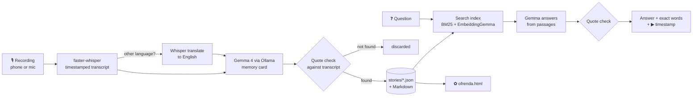

# 🕯️ Séance

**Ask your family's stories a question. Hear the answer in their own voice.**

Séance is a private, offline archive for the stories your elders tell. Record your
grandmother talking about the house she grew up in. An open Whisper model transcribes it,
Gemma (running on your own computer through Ollama) writes a memory card, and later you can
ask the archive things like _"What did Grandma say about the monsoon?"_ The answer comes
back with her exact words, the minute she said them, and a button that plays that moment.

It also builds an **ofrenda**, a single web page in the spirit of Día de los Muertos, that
gathers each person's words, places, years and the questions you still want to ask them.

<!-- Replace with your demo video link -->

> 🎬 **Demo:** [Watch on YouTube](https://youtu.be/5RSh-lp1GBw)

Built for the [DEV Hacktoberfest 2026 Open-Source AI Challenge, Week 4: Ghost in the Machine](https://dev.to/challenges/hacktoberfest-week4-2026-10-26).

---

## The one rule: never put words in anyone's mouth

A tool like this is only worth anything if you can trust it. So Gemma is never allowed to
quote anyone directly. When it picks a quote for a memory card, or quotes a passage to answer
a question, Séance looks for those words in the real transcript:

- If they're there, the quote shown is the **transcript's wording**, with its timestamp.
- If they're slightly off, the transcript's version replaces Gemma's.
- If they aren't there at all, the quote is **thrown away**, and `seance stats` counts how
  often that happened.

If an answer can't be backed by anything actually said, Séance says so and shows you the
closest passages instead. There is no "talk to Grandma" chatbot, by design.

## What it looks like

```text
$ seance add "Ammachi 2026-10-27.m4a" --speaker Grandma

🎙️  Ammachi 2026-10-27.m4a: 1412 words · 9 min 40s of audio transcribed in 71.2s · Gemma took 52.0s

🕯️  The house with the mango tree  (2026-10-27-the-house-with-the-mango-tree)
    Grandma · recorded 2026-10-27 · 9 min 40s
    Grandma describes her childhood home in Kottayam, her strict father ...

    In their words:
     [00:31] Mangoes for the whole street
        “Every May the whole street came for our mangoes, and my mother would send a basket to the church too.”
     [01:10] The 1961 flood
        “In 1961 the water came right up to the verandah steps.”
    ...
    Ask Grandma next time:
     · What happened to Joseph after he broke his arm?
```

```text
$ seance ask "What was the flood like?" --play

🕯️  Grandma said that in 1961 the water came up to the verandah steps, so they put the rice
    sacks on the beds and she slept on top of the cupboard with her sister Annamma.

   “In 1961 the water came right up to the verandah steps. We put the rice sacks on the beds”
      — Grandma, “The house with the mango tree” at 01:10

   ▶ playing Grandma at 01:10...
```

_(The output above is illustrative; the numbers depend on your computer and recording.)_

## How it works



1. **Transcribe.** faster-whisper runs the open Whisper weights on your CPU and keeps the
   timestamp of every segment. Phone formats (`.m4a`, `.opus`, `.mp3`) work directly.
   For recordings in Malayalam, Hindi, Arabic and other languages, `--translate` also makes
   an English translation, and the original words are kept next to each quote.
2. **Memory card.** Gemma reads the transcript and returns, as JSON constrained by Ollama's
   structured outputs: a title, a summary, the people, places and years mentioned, the most
   vivid moments with quotes, themes, and follow-up questions for next time. Long recordings
   are read in parts and merged.
3. **Verify.** Every quote is located in the transcript (in-order fuzzy matching) and replaced
   with the transcript's own words and timestamp, or dropped.
4. **Index.** Transcripts are cut into short overlapping passages. Search combines keyword
   search (BM25, pure Python) with EmbeddingGemma vectors if you've pulled that model.
   Each passage is also tagged with the card's moment headings, so _"the flood"_ finds a
   passage where Grandma only ever said _"the water came up to the steps"_.
5. **Ask.** Gemma answers from the top passages and must cite them by quoting; the quotes go
   through the same check as step 3.
6. **Ofrenda.** One offline HTML page per archive. Every quote has a ▶ button that plays that
   exact moment from the original recording.

## Quick start

You need Python 3.10 or newer and [Ollama](https://ollama.com/download).

### 1. Get the models

```bash
ollama pull gemma4:e4b        # the brain: memory cards and answers
ollama pull embeddinggemma    # optional: smarter search (a small Gemma embedding model)
```

Smaller Gemma tags such as `gemma4:e2b` are faster on modest laptops. Check
[ollama.com/library](https://ollama.com/library) for the current tags; the names above are
the ones this project was written against.

### 2. Install Séance

```bash
git clone https://github.com/clyv/seance.git
cd seance
python -m venv .venv
```

Activate the environment, then install:

```bash
# Windows (PowerShell)
.venv\Scripts\Activate.ps1
# macOS / Linux
source .venv/bin/activate

pip install -e ".[audio]"     # [audio] adds microphone recording and playback
```

### 3. Set up and check

```bash
seance init       # creates ~/Seance with config.toml, recordings/, stories/
seance doctor     # checks Whisper, PyAV, Ollama, Gemma, and makes a test memory card
```

The first audio file downloads the Whisper model once (`small` is a few hundred MB).
After that, everything runs with the internet off.

### 4. Try it

```bash
seance add samples/grandma_the_house_in_kerala.txt --speaker Grandma
seance add samples/grandpa_coming_to_dubai.txt --speaker Grandpa
seance ask "How did Grandpa get to Dubai?"
seance ofrenda --open
```

Then with a real voice:

```bash
seance record --speaker Grandma                 # press Enter to stop
seance add "Voice 001.m4a" --speaker Grandpa    # or any recording from your phone
seance add "PTT-20261028-WA0003.opus" --speaker Ammachi --language ml --translate
```

## Using recordings you already have

You don't need to be in the same room. Most families already have the recordings:

| Where it comes from                      | Usual file                 | How to get it onto your laptop                                                           |
| ---------------------------------------- | -------------------------- | ---------------------------------------------------------------------------------------- |
| WhatsApp voice notes                     | `PTT-20261028-WA0003.opus` | Long-press the note → Share → save or email to yourself, or export the chat with media   |
| Phone call recorder                      | `.m4a`, `.amr`, `.3gp`     | Copy from the phone's recordings folder (ask the person first; call recording laws vary) |
| Voice recorder apps                      | `.m4a`, `.mp3`, `.wav`     | Share or sync the file                                                                   |
| Family videos                            | `.mp4`, `.mov`, `.mkv`     | The sound track is used; the video isn't copied                                          |
| Old dictaphones, CDs, Windows recordings | `.wma`, `.aiff`, `.flac`   | Copy the files over                                                                      |

```bash
seance add "PTT-20261028-WA0003.opus" --speaker Ammachi
seance add "D:/Family/Ammachi voice notes" --speaker Ammachi     # a whole folder, one person
```

Séance reads anything FFmpeg can decode, which covers all of the above. Dates are taken from
names like `PTT-20261028-...` or `2026-10-28`, otherwise from the file's date; `--date` overrides.
For the ofrenda's ▶ buttons, formats every browser plays (`.mp3 .m4a .wav .ogg .opus .flac`) are
copied into the archive as they are, and anything else (`.amr .3gp .wma .aiff`, videos) gets a
small 16 kHz WAV listening copy. Your original files are never changed.

## Malayalam and other languages

Whisper understands about a hundred languages, including Malayalam (`ml`), Hindi (`hi`),
Tamil (`ta`) and Arabic (`ar`). There are three ways to use them:

1. **Transcribe and translate (recommended to start).**
   ```bash
   seance add "Ammachi.m4a" --speaker Ammachi --language ml --translate
   ```
   You get the Malayalam transcript and Whisper's English translation. Gemma reads the English,
   quotes are checked against the English, and each quote shows the Malayalam words spoken at
   that moment underneath. Giving `--language` avoids Whisper mis-detecting the language.
2. **Malayalam only.** Leave out `--translate`. Gemma reads the Malayalam directly and writes the
   card in English, with quotes kept in Malayalam. How well this works depends on Gemma's
   Malayalam; I haven't tested it.
3. **A Malayalam-tuned Whisper, for better transcripts.** Standard Whisper's Malayalam is weak.
   Community models fine-tuned on Malayalam are available in the CTranslate2 format faster-whisper
   uses, for example [`adalat-ai/ct2-whisper-medium-ml-rmft`](https://huggingface.co/adalat-ai/ct2-whisper-medium-ml-rmft)
   (Apache 2.0). In `config.toml`:
   ```toml
   [whisper]
   model = "adalat-ai/ct2-whisper-medium-ml-rmft"
   translate_model = "medium"   # fine-tunes usually can't translate, so use standard Whisper for that
   language = "ml"
   ```
   Even fine-tuned, its model card reports roughly 40% word error rate overall on its benchmark
   (about 46% on spontaneous speech), so expect to correct names and places. It's a `medium`
   model: a bigger download and slower on a CPU than `small`.

Speech that mixes Malayalam and English in one sentence is common and harder for every model.
Whatever you choose, read the transcript of anything important; the quote check guarantees the
words are in the transcript, not that the transcript heard them right.

## Recording tips

- **Ask first.** Tell the person what you're recording and that it stays on your computer.
- Sit close, in a quiet room, with the phone between you. Fans and TVs hurt transcription.
- Open questions work best: _"Tell me about the house you grew up in."_ Then let them talk.
- Run `seance questions` before your next visit. Gemma suggests follow-ups about things they
  mentioned but didn't explain.
- Add details for the ofrenda: `seance person Grandma --relation "Dad's mother" --years "1940–2021" --photo grandma.jpg`

## Commands

| Command                                                                     | What it does                                                     |
| --------------------------------------------------------------------------- | ---------------------------------------------------------------- |
| `seance init [--home DIR]`                                                  | Create the archive folder and config                             |
| `seance doctor [--quick]`                                                   | Check Whisper, PyAV, Ollama, Gemma and EmbeddingGemma            |
| `seance add FILE... -s NAME [--title T] [--date D] [-l LANG] [--translate]` | Add recordings or `.txt` transcripts (or a whole folder)         |
| `seance record -s NAME [--seconds N] [-l LANG] [--translate]`               | Record from the microphone, then add                             |
| `seance ask ["QUESTION"] [-s NAME] [--play] [--passages]`                   | Ask a question; no question starts an interactive séance         |
| `seance play STORY [mm:ss] [--moment N]`                                    | Play a moment from a story                                       |
| `seance list` / `seance show STORY [--transcript]`                          | Browse stories and memory cards                                  |
| `seance person NAME [--relation] [--years] [--photo] [--note]`              | Details for the ofrenda                                          |
| `seance people` / `seance questions [-s NAME]`                              | Who's in the archive; what to ask next time                      |
| `seance ofrenda [--title T] [-s NAME] [--open]`                             | Rebuild the ofrenda page                                         |
| `seance reindex`                                                            | Rebuild search (e.g. after pulling `embeddinggemma`)             |
| `seance remove STORY`                                                       | Move a story to the archive's `trash/` folder                    |
| `seance stats`                                                              | What's in the archive, speeds, and how many quotes were rejected |

## The archive is just files

```
~/Seance/
├── config.toml
├── ofrenda.html          ← open in any browser, no server needed
├── ARCHIVE.md            ← people, timeline, places, questions for next time
├── stories/
│   ├── 2026-10-27-the-house-with-the-mango-tree.json
│   └── 2026-10-27-the-house-with-the-mango-tree.md   ← card + full timestamped transcript
├── recordings/           ← your original audio
├── photos/
├── people.json
└── index.json            ← search passages (+ embeddings)
```

Everything is plain JSON, Markdown and audio, so the archive outlives this program. Back
the folder up like any other family photos.

## Configuration

`seance init` writes `~/Seance/config.toml`; see [`config.example.toml`](config.example.toml).
The settings you're most likely to change:

- `[llm] model`: which Gemma tag to use.
- `[whisper] model`: `small` is a good default; `medium` or `large-v3` handle accents,
  older voices and other languages noticeably better, at the cost of speed.
- `[whisper] language`: set it (for example `"ml"` for Malayalam) if auto-detection guesses wrong.
- `[whisper] translate = true`: always make English translations of non-English recordings.
- `[whisper] device = "cuda"` and `compute_type = "float16"` if you have an NVIDIA GPU with CUDA 12.

Config is looked up in this order: `--config PATH`, `$SEANCE_CONFIG`, `./seance.toml`,
then `~/Seance/config.toml` (or `$SEANCE_HOME/config.toml`).

## Privacy

- Recordings, transcripts, cards and the ofrenda stay in your archive folder.
- The only network calls are to Ollama on `localhost`, plus a one-time download of the
  Whisper weights from Hugging Face.
- `.gitignore` keeps audio and archives out of git.

## Limitations

- **No speaker separation.** Whisper doesn't tell voices apart, so your questions are in the
  transcript too. The prompts tell Gemma the card is about the storyteller's memories.
- **Transcription isn't perfect,** especially for older voices, phone-call audio, strong accents
  and languages Whisper has less training data for, such as Malayalam. I haven't measured
  accuracy myself; check the transcript of anything important. See "Malayalam and other languages".
- **Translation is Whisper's own,** which is rough. The original-language words are kept
  next to each quote so a family member can check them.
- **Quote checking is fuzzy matching, not understanding.** It guarantees the words were said;
  it can't guarantee Gemma's summary captures what was meant.
- Times are kept to the second; years are as spoken ("when I was ten" stays as it is).

## Development

```bash
pip install -e ".[dev]"
pytest
```

The tests replace Whisper and Gemma with fakes, including a fake Ollama HTTP server, so they
run offline in a couple of seconds.

```
seance/
├── cli.py          commands
├── pipeline.py     recording → transcript → card → archive, index, ofrenda
├── transcribe.py   faster-whisper wrapper (timestamps, translation)
├── transcript.py   segments, timestamps, and find_quote (the quote check)
├── card.py         memory-card prompt, schema, parts-and-merge, quote verification
├── search.py       passages, BM25, EmbeddingGemma, rank fusion
├── ask.py          question answering with verified citations
├── archive.py      stories, people and the log on disk
├── render.py       story Markdown and ARCHIVE.md
├── ofrenda.py      the ofrenda HTML page
├── audio.py        microphone recording and clip playback
├── llm.py          small Ollama client (standard library only)
└── config.py       settings
```

## Credits

Séance stands on these open projects:

- [Gemma](https://ai.google.dev/gemma) and EmbeddingGemma by Google DeepMind, the open-weight models that do the understanding and search
- [Ollama](https://github.com/ollama/ollama) for serving them locally
- [faster-whisper](https://github.com/SYSTRAN/faster-whisper) and OpenAI's open [Whisper](https://github.com/openai/whisper) weights for transcription and translation
- [PyAV](https://github.com/PyAV-Org/PyAV) for decoding phone audio
- [sounddevice](https://github.com/spatialaudio/python-sounddevice) for recording and playback

The Ollama client (`llm.py`) and the microphone recorder (`audio.py`) are adapted from my
earlier Hacktoberfest project, [TalkDown](https://github.com/clyv/talkdown). Everything else
was written for this challenge. Built with help from an AI coding assistant.

## License

MIT © 2026 Clivin John Geju
