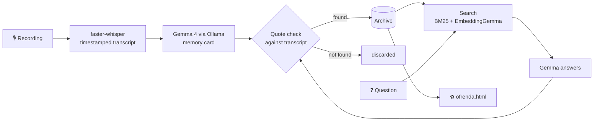

<!--
HOW TO USE THIS DRAFT
- On dev.to, the title and tags go in their own boxes. Paste only what's BELOW this comment.
- Replace every ⟨angle-bracket⟩ placeholder with something true from your own use.
- Delete any claim you haven't checked yourself.
- Delete this comment before publishing.
-->

*This is a submission for the [Hacktoberfest Open-Source AI Challenge Week 4: Ghost in the Machine](https://dev.to/challenges/hacktoberfest-week4-2026-10-26)*

## What I Built

**Séance** is a private archive for the stories your family tells, and a way to ask those stories questions.

You record your grandmother talking about the house she grew up in, or just drop in the WhatsApp voice notes she already sends you. An open Whisper model transcribes it on your laptop. Gemma 4, also on your laptop, turns it into a memory card: the people, places and years she mentioned, the most vivid moments in her own words, and questions you could ask her next time.

Later you can ask the archive *"What did Grandma say about the monsoon?"* The answer comes back with her exact words, the minute she said them, and a ▶ button that plays that moment in her voice.

I read the theme two ways. "Ghost in the Machine" made me think of the voices of people we've lost, still there in old voice notes. Día de los Muertos is about keeping those people present by remembering them out loud. So Séance also builds an **ofrenda**: one offline web page per family, with each person's words, places, years and the questions still left to ask.

The one thing it will never do is make someone say something they didn't. There is no "chat with Grandma" bot. Every quote is checked against the transcript, and anything that can't be found is thrown away.

## Demo

⟨Embed your video: ⟩

## Code



## How I Built It

**The open stack, all running locally:**

- **[faster-whisper](https://github.com/SYSTRAN/faster-whisper)** with OpenAI's open Whisper weights. It keeps a timestamp for every segment, which is what makes "play the moment she said it" possible. For recordings in other languages, Whisper's translate mode adds an English version, and the original words stay next to each quote.
- **Gemma 4 (`gemma4:e4b`) through [Ollama](https://ollama.com)** writes the memory cards and answers questions. Ollama's structured outputs constrain every reply to a JSON schema.
- **EmbeddingGemma** (optional) for semantic search, combined with plain BM25 keyword search through reciprocal rank fusion.
- **Plain Python** for everything else. The Ollama client is a small standard-library module.

Three decisions shaped it.

**1. Gemma chooses; code quotes.** When Gemma picks a quote for a memory card, Séance finds those words in the transcript with an in-order fuzzy match, then shows the *transcript's* wording with its timestamp. If Gemma tidied the grammar, the original wording wins. If the words aren't there at all, the quote is discarded. Answers to questions go through the same check: Gemma must cite a passage by quoting it, and an answer with no verifiable quote is flagged instead of shown as fact.

⟨Fill in from `seance stats` after real use: "Across ⟨N⟩ recordings, Gemma suggested ⟨X⟩ quotes and ⟨Y⟩ were rejected because they weren't in the recording." If Y is 0, say that too; it's still the right guard to have.⟩

**2. Search in two vocabularies.** People don't ask questions in the words the speaker used. Grandma never says "flood"; she says "the water came right up to the verandah steps". So each transcript passage is also tagged with the memory card's headings for the moments inside it, which are in Gemma's words ("The 1961 flood"). Keyword search alone then finds the passage, and EmbeddingGemma helps further when it's installed.

**3. Long recordings in parts.** A real conversation with a grandparent runs well past a small model's comfortable context. Long transcripts are carded in parts, the lists are merged in code, and Gemma writes one title and summary from the part summaries.

The repo has 56 tests that replace Whisper and Gemma with fakes, including a fake Ollama HTTP server. They pass on Python 3.10 and 3.13.

**What a real Windows laptop taught me.** I built my Week 3 project, TalkDown, on the same stack, and its first real run failed twice in ways the tests didn't catch: the newest PyAV dropped an argument faster-whisper passes, and Whisper's `device = "auto"` tried to load CUDA libraries that weren't installed. Séance pins PyAV, defaults to CPU, and `seance doctor` checks for both and prints the one-line fix.

## Why Does Open Innovation Matter?

These are some of the most private recordings a family has: an elderly parent's memories, sometimes their health, sometimes old arguments, sometimes the last recording of their voice. I don't want to upload them to a service to get a summary.

With open models running locally:

- **Nothing leaves the laptop.** ⟨Keep only after checking: I turned Wi-Fi off and added a recording and asked questions end to end.⟩
- **It will still work in twenty years.** A family archive has to outlive the tools that made it. If a hosted API shuts down or changes its terms, an archive built on it breaks. Here the archive is plain JSON, Markdown and audio, and the models are files on disk.
- **It speaks the family's languages.** ⟨Only if true: My grandparents speak Malayalam,⟩ a language big general models handle poorly. Because the stack is open, I can swap in a Whisper model the Malayalam open-source community fine-tuned, with one line of config, and keep using standard Whisper for the English translation. ⟨Fill in after trying: how standard Whisper and the Malayalam-tuned model actually did on your recording, honestly.⟩
- **I can inspect every rule.** The prompt, the quote-matching threshold and the search weights are all in the repo, so if it misquotes someone, I can see why and fix it.

Where closed models are better: a frontier API would summarise a chaotic two-hour conversation more reliably than a small model on a laptop, and would probably transcribe accented speech better than Whisper `small`. For a family archive, privacy and permanence matter more to me than that last bit of quality, and the quote check means the weaker model can't put words in anyone's mouth.

## The Spirit of It

⟨Optional, but this is where your post can stand out. Write two or three honest sentences about a real moment: the first recording you made with a family member, something you heard that you'd never heard before, or what it felt like to hear a voice play back from the ofrenda. Don't invent this; if you haven't had the moment yet, delete this section.⟩

## Prize Categories

- **Best Use of Gemma.** Gemma 4 writes every memory card and answers every question, running locally through Ollama with structured outputs; EmbeddingGemma powers semantic search. Both are core to the project, not add-ons.

Thanks for reading. Ask your elders about the house they grew up in. 🕯️
